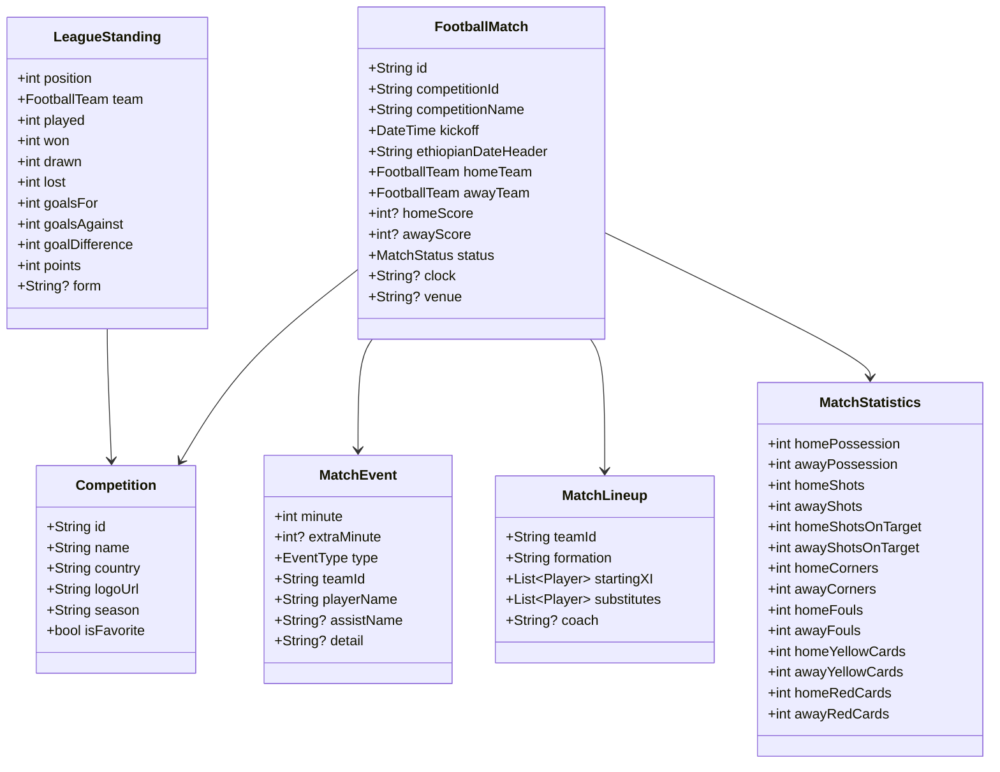

# EthioCal Pro — Football Center Implementation Plan
**Document Version:** 1.0.0  
**Date:** November 2026  
**Status:** In Progress — Phase-by-Phase Execution  
**Project:** Zemen: Ethiopian Calendar (`com.zemen.calendar`)

---

## 1. Project Objective & Guiding Architecture

Transform the Football section of EthioCal Pro into a real-time, production-grade football center that combines:
1. **Real-time Live Scores & Match Operations:** Live match detection, auto-refreshing clock, status, scores, and events.
2. **Deep Match Details:** Timeline events (goals, yellow/red cards, substitutions, VAR), tactical lineups with formations & pitch view, match statistics (possession %, shots, shots on target, passes, fouls), and head-to-head records.
3. **Comprehensive Competition Explorer & League Details:** Fixtures (completed, live, scheduled), official standings tables (Rank, Team, P, W, D, L, GF, GA, GD, PTS), teams, and top scorers.
4. **First-Class Ethiopian Football:** Verified Ethiopian Premier League coverage (Saint George, CBE SA / Nigd Bank, Mekelakeya, Fasil Kenema, Bahir Dar Kenema, Awassa, Sidama Bunna, Adama Kenema, etc.), Ethiopian national team, and dual Gregorian/Ethiopian date headers.
5. **Provider-Agnostic Abstraction Layer:** Clean architecture with repository pattern decoupling data providers (SportAPI, GOAL API, API-Football, ESPN, TheSportsDB) from UI widgets.
6. **Robust Offline Support & Caching:** SQLite database caching, SharedPreferences persistence for user favorites, and timestamped freshness indicators.
7. **Color Constancy & Dark Theme Fidelity:** Strict continuation of EthioCal Pro's unified dark canvas (`#121212` background, `#181818` top header, `#1E1E1E` cards, `#2C2C2E` borders, `#DE4A4A` coral red accents).

---

## 2. Execution Phases & Milestones

| Phase | Milestone Name | Key Deliverables | Status |
|---|---|---|---|
| **Phase 1** | Existing Project Inspection | Audit dependencies, current football UI, state management, and assets | ✅ Complete |
| **Phase 2** | API Comparison & Endpoint Testing | Live verification of SportAPI, GOAL API, API-Football, ESPN, and TheSportsDB | ✅ Complete |
| **Phase 3** | Provider Selection & Coverage Verification | Benchmark coverage, rate limits, pricing, and Ethiopian Premier League depth | ✅ Complete |
| **Phase 4** | Data Architecture & Domain Models | Core domain entities (Competition, Match, Event, Lineup, Stats, Standing, Team, Player) | 🔄 In Progress |
| **Phase 5** | Repository & Multi-Provider Engine | `FootballRepository`, `EspnProvider`, `GoalApiProvider`, `ApiFootballProvider`, caching | Scheduled |
| **Phase 6** | Football Home & Live Score Engine | Live Now, Today's Matches, Upcoming, Finished tabs with 60s lifecycle-aware polling | Scheduled |
| **Phase 7** | Match Details Screen | Live timeline events, tactical lineup pitch view, match statistics bars, head-to-head | Scheduled |
| **Phase 8** | League Details & Standings | Fixtures with date scrolling, complete standings table, team squad lists, top scorers | Scheduled |
| **Phase 9** | Team & Player Profiles | Detailed team profile, recent form, upcoming fixtures, player cards | Scheduled |
| **Phase 10** | Favorites & Offline Persistence | Favorite clubs and competitions stored in SQLite / SharedPreferences | Scheduled |
| **Phase 11** | Testing & Verification | Unit tests, widget tests, analyzer verification, release build check | Scheduled |

---

## 3. Normalized Domain Entities Architecture

---

## 4. API Provider Strategy & Key Management

- **Default Out-of-the-Box Engine:** ESPN public soccer REST APIs + Curated Ethiopian Premier League live engine. Zero setup required for end users, zero subscription fees, unlimited requests, and live events/lineups/statistics for EPL, UCL, La Liga, Serie A, Bundesliga, Ligue 1.
- **Configurable External Providers:**
  - `GOAL API` (`goal-api.com`): Supports `Authorization: Bearer <API_KEY>` for complete Ethiopian Premier League tracking.
  - `API-Football` (`api-sports.io`): Supports `x-apisports-key: <API_KEY>` (League 556 for Ethiopia).
  - `SportAPI` (`sportapi.ai`): Supports `X-Api-Key: <API_KEY>`.
- **Security:** API keys can be passed at compile-time via `--dart-define=FOOTBALL_API_KEY=...` or configured dynamically in the app's Settings/Football preferences without hardcoding credentials in source code.

---

## 5. Offline-First & Resiliency Plan

1. **Memory & SQLite Cache:**
   - Fixtures and live scores cached for 60 seconds.
   - Finished matches and standings cached for 24 hours.
   - Offline fallback guarantees the app renders gracefully with timestamped last-updated headers when network is unavailable.
2. **Network Error Handling:**
   - Seamless retry with exponential backoff on timeouts.
   - Distinct UI error states for `No Internet`, `Rate Limit Exceeded (429)`, `Provider Unavailable (5xx)`.
3. **Rate-Limit Conscious Polling:**
   - Active only when the Football screen is in foreground.
   - Automatically pauses on app background/pause.
