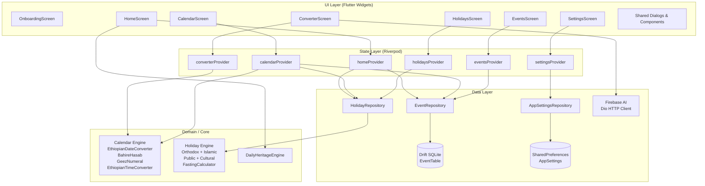

# EthioCal Pro – Flutter Technical Architecture

## 1. Architecture Overview

EthioCal Pro Flutter follows a **feature-first clean architecture** with:

- **State management:** Riverpod 2.x (`StateNotifier` + `AsyncNotifier` + code-gen)
- **Navigation:** `go_router` with typed routes
- **Local database:** Drift (SQLite) – mirrors the Kotlin Room schema
- **Preferences:** `shared_preferences` wrapped in a typed `AppSettingsRepository`
- **Networking:** Dio with `retrofit` codegen interceptors
- **Serialization:** `freezed` + `json_serializable` (replaces Moshi)
- **Dependency injection:** Riverpod providers (no service locator needed)
- **Testing:** `flutter_test` + `mockito`/`mocktail` + `integration_test`

---

## 2. Folder Structure

```
lib/
├── main.dart                        # Entry point: Firebase init, ProviderScope, AppRouter
├── app.dart                         # MaterialApp.router, theme wiring, locale
│
├── core/                            # Shared infrastructure (no feature deps)
│   ├── calendar/                    # Pure Dart calendar engine
│   │   ├── ethiopian_date.dart
│   │   ├── ethiopian_date.freezed.dart
│   │   ├── gregorian_date.dart
│   │   ├── ethiopian_month.dart
│   │   ├── ethiopian_date_converter.dart
│   │   ├── leap_year_calculator.dart
│   │   ├── bahire_hasab.dart
│   │   ├── geez_numeral.dart
│   │   ├── ethiopian_time_converter.dart
│   │   └── ethiopian_season.dart
│   │
│   ├── theme/                       # AppTheme + 4 accent palettes
│   │   ├── app_theme.dart
│   │   └── palettes/
│   │       ├── gold_emerald.dart    # Primary #E6A817
│   │       ├── royal_indigo.dart
│   │       ├── crimson.dart
│   │       └── terracotta.dart
│   │
│   ├── notifications/
│   │   ├── notification_scheduler.dart
│   │   └── boot_reschedule.dart
│   │
│   ├── export/
│   │   └── ics_exporter.dart
│   │
│   ├── heritage/
│   │   └── daily_heritage_engine.dart   # 30 Ethiopian proverbs
│   │
│   └── utils/
│       ├── date_utils.dart
│       └── string_utils.dart
│
├── data/                            # Data layer (repositories, DB, remote)
│   ├── local/                       # Drift database
│   │   ├── app_database.dart        # @DriftDatabase root
│   │   ├── event_table.dart         # Drift Table definition
│   │   ├── event_dao.dart           # CRUD + queries
│   │   └── migration_helper.dart    # Kotlin Room DB → Drift migration
│   │
│   ├── preferences/
│   │   ├── app_settings.dart        # Freezed settings model
│   │   └── app_settings_repository.dart  # SharedPreferences wrapper
│   │
│   ├── models/                      # Freezed domain models + JSON
│   │   ├── event.dart
│   │   ├── event.freezed.dart
│   │   ├── event.g.dart
│   │   ├── holiday.dart
│   │   ├── holiday.freezed.dart
│   │   ├── recurrence_type.dart     # Enum: NONE, DAILY, WEEKLY, …
│   │   └── event_category.dart      # Enum: BIRTHDAY, MEETING, …
│   │
│   ├── repositories/
│   │   ├── event_repository.dart
│   │   └── holiday_repository.dart
│   │
│   └── remote/
│       ├── api_service.dart         # Dio + Retrofit-style client
│       └── firebase_ai_client.dart  # Firebase AI / Gemini
│
├── features/                        # One folder per screen / feature
│   ├── onboarding/
│   │   ├── screens/
│   │   │   └── onboarding_screen.dart
│   │   └── widgets/
│   │       └── onboarding_page.dart
│   │
│   ├── home/
│   │   ├── providers/
│   │   │   └── home_provider.dart
│   │   ├── screens/
│   │   │   └── home_screen.dart
│   │   └── widgets/
│   │       ├── today_date_card.dart
│   │       ├── upcoming_holiday_card.dart
│   │       ├── quick_actions.dart
│   │       └── today_events_list.dart
│   │
│   ├── calendar/
│   │   ├── providers/
│   │   │   └── calendar_provider.dart
│   │   ├── screens/
│   │   │   └── calendar_screen.dart
│   │   └── widgets/
│   │       ├── month_view.dart
│   │       ├── week_view.dart
│   │       ├── day_view.dart
│   │       ├── year_view.dart
│   │       └── event_markers.dart
│   │
│   ├── converter/
│   │   ├── providers/
│   │   │   └── converter_provider.dart
│   │   ├── screens/
│   │   │   └── converter_screen.dart
│   │   └── tabs/
│   │       ├── date_converter_tab.dart
│   │       ├── age_calculator_tab.dart
│   │       ├── date_diff_tab.dart
│   │       ├── geez_numeral_tab.dart
│   │       ├── time_converter_tab.dart
│   │       ├── timezone_tab.dart
│   │       ├── fasting_guide_tab.dart
│   │       ├── bahire_hasab_tab.dart
│   │       ├── monthly_saints_tab.dart
│   │       └── greeting_card_tab.dart
│   │
│   ├── holidays/
│   │   ├── data/
│   │   │   ├── orthodox_holidays.dart
│   │   │   ├── islamic_holidays.dart
│   │   │   ├── public_holidays.dart
│   │   │   ├── cultural_events.dart
│   │   │   ├── monthly_saints.dart
│   │   │   └── fasting_calculator.dart
│   │   ├── providers/
│   │   │   └── holidays_provider.dart
│   │   ├── screens/
│   │   │   └── holidays_screen.dart
│   │   └── widgets/
│   │       ├── holiday_list_tile.dart
│   │       ├── holiday_detail_dialog.dart
│   │       ├── holiday_card_share_dialog.dart
│   │       └── set_holiday_reminder_dialog.dart
│   │
│   ├── events/
│   │   ├── providers/
│   │   │   └── events_provider.dart
│   │   ├── screens/
│   │   │   └── events_screen.dart
│   │   └── widgets/
│   │       ├── event_list_tile.dart
│   │       ├── add_edit_event_dialog.dart
│   │       ├── recurrence_picker.dart
│   │       ├── reminder_picker.dart
│   │       └── color_picker.dart
│   │
│   └── settings/
│       ├── providers/
│       │   └── settings_provider.dart
│       ├── screens/
│       │   └── settings_screen.dart
│       └── widgets/
│           ├── language_selector.dart
│           ├── numeral_type_selector.dart
│           ├── theme_mode_selector.dart
│           └── accent_palette_selector.dart
│
├── shared/                          # Cross-feature reusable widgets
│   └── widgets/
│       ├── dual_date_picker.dart
│       ├── ethiopian_clock_dialog.dart
│       └── widget_management_dialog.dart
│
└── platform/                        # Platform-specific native bridges
    └── widgets/                     # Home screen widgets
        ├── full_widget/
        └── compact_widget/

assets/
├── fonts/
│   └── NotoSerifEthiopic-Regular.ttf
├── images/
│   └── onboarding/
└── l10n/
    ├── app_en.arb
    └── app_am.arb                   # Amharic translations

test/
├── core/
│   ├── calendar/
│   │   ├── ethiopian_date_converter_test.dart
│   │   ├── bahire_hasab_test.dart
│   │   └── geez_numeral_test.dart
│   └── ...
├── features/
│   ├── home/
│   ├── calendar/
│   └── events/
└── data/
    ├── event_repository_test.dart
    └── holiday_repository_test.dart

integration_test/
└── app_test.dart
```

---

## 3. State Management with Riverpod

### Provider Hierarchy

```
ProviderScope (root)
│
├── appDatabaseProvider          → AppDatabase (Drift singleton)
├── eventRepositoryProvider      → EventRepository
├── holidayRepositoryProvider    → HolidayRepository
├── appSettingsRepositoryProvider → AppSettingsRepository
│
├── settingsProvider             → AsyncNotifier<AppSettings>
│    ↳ language, theme, accent, numeralType, …
│
├── homeProvider                 → StateNotifier<HomeState>
│    ↳ watches: todayDateProvider, upcomingHolidayProvider, todayEventsProvider
│
├── calendarProvider             → StateNotifier<CalendarState>
│    ↳ selectedDate, viewMode, events, holidays
│
├── eventsProvider               → AsyncNotifier<List<Event>>
│    ↳ search query, category filter
│
├── holidaysProvider             → AsyncNotifier<List<Holiday>>
│    ↳ selected year, category filter
│
└── converterProvider            → StateNotifier<ConverterState>
     ↳ per-tab sub-providers (lazy)
```

### Code-Gen Pattern (Riverpod + Freezed)

```dart
// State model
@freezed
class CalendarState with _$CalendarState {
  const factory CalendarState({
    required EthiopianDate selectedDate,
    required CalendarViewMode viewMode,
    @Default([]) List<Event> events,
    @Default([]) List<Holiday> holidays,
  }) = _CalendarState;
}

// Notifier
@riverpod
class CalendarNotifier extends _$CalendarNotifier {
  @override
  CalendarState build() => CalendarState(
        selectedDate: EthiopianDateConverter.todayEthiopian(),
        viewMode: CalendarViewMode.month,
      );

  void selectDate(EthiopianDate date) =>
      state = state.copyWith(selectedDate: date);

  void setViewMode(CalendarViewMode mode) =>
      state = state.copyWith(viewMode: mode);
}
```

---

## 4. Navigation (go_router)

```dart
final router = GoRouter(
  initialLocation: '/home',
  redirect: (context, state) {
    final onboardingDone = ref.read(settingsProvider).value?.onboardingCompleted ?? false;
    if (!onboardingDone && state.matchedLocation != '/onboarding') {
      return '/onboarding';
    }
    return null;
  },
  routes: [
    GoRoute(path: '/onboarding', builder: (_, __) => const OnboardingScreen()),
    StatefulShellRoute.indexedStack(
      builder: (_, __, shell) => AppScaffold(shell: shell),
      branches: [
        StatefulShellBranch(routes: [GoRoute(path: '/home',      builder: (_, __) => const HomeScreen())]),
        StatefulShellBranch(routes: [GoRoute(path: '/calendar',  builder: (_, __) => const CalendarScreen())]),
        StatefulShellBranch(routes: [GoRoute(path: '/converter', builder: (_, __) => const ConverterScreen())]),
        StatefulShellBranch(routes: [GoRoute(path: '/holidays',  builder: (_, __) => const HolidaysScreen())]),
        StatefulShellBranch(routes: [GoRoute(path: '/events',    builder: (_, __) => const EventsScreen())]),
        StatefulShellBranch(routes: [GoRoute(path: '/settings',  builder: (_, __) => const SettingsScreen())]),
      ],
    ),
  ],
);
```

---

## 5. Database Schema (Drift)

```dart
class EventTable extends Table {
  IntColumn get id          => integer().autoIncrement()();
  TextColumn get title      => text().withLength(min: 1, max: 200)();
  TextColumn get description => text().nullable()();
  TextColumn get category   => text()();             // EventCategory enum value
  IntColumn  get ethiopianYear  => integer()();
  IntColumn  get ethiopianMonth => integer()();      // 1–13
  IntColumn  get ethiopianDay   => integer()();
  IntColumn  get gregorianYear  => integer()();
  IntColumn  get gregorianMonth => integer()();
  IntColumn  get gregorianDay   => integer()();
  IntColumn  get hour       => integer().nullable()();
  IntColumn  get minute     => integer().nullable()();
  BoolColumn get isAllDay   => boolean().withDefault(const Constant(false))();
  TextColumn get recurrence => text().withDefault(const Constant('NONE'))();
  IntColumn  get reminderMinutesBefore => integer().nullable()();
  TextColumn get colorHex   => text().withDefault(const Constant('#E6A817'))();
  BoolColumn get isCompleted => boolean().withDefault(const Constant(false))();
  DateTimeColumn get createdAt => dateTime().withDefault(currentDateAndTime)();
}
```

---

## 6. Theming

```dart
// AppTheme.dart
ThemeData buildTheme({
  required AccentPalette palette,
  required ThemeMode mode,
}) {
  final colorScheme = ColorScheme.fromSeed(
    seedColor: palette.primaryColor,
    brightness: mode == ThemeMode.dark ? Brightness.dark : Brightness.light,
  );
  return ThemeData(
    useMaterial3: true,
    colorScheme: colorScheme,
    // AMOLED override
    scaffoldBackgroundColor: mode == ThemeMode.amoled ? Colors.black : null,
  );
}

enum AccentPalette {
  goldEmerald(primaryColor: Color(0xFFE6A817)),
  royalIndigo(primaryColor: Color(0xFF3F51B5)),
  crimson(primaryColor: Color(0xFFD32F2F)),
  terracotta(primaryColor: Color(0xFFBF5700));

  const AccentPalette({required this.primaryColor});
  final Color primaryColor;
}
```

---

## 7. Architecture Diagram



---

## 8. Key Technical Decisions

| Decision | Rationale |
|----------|-----------|
| Drift over Isar | Drift is SQL-based like Room; schema migration is straightforward |
| Riverpod over BLoC | Less boilerplate; aligns with Compose ViewModel pattern |
| go_router over auto_route | Official Flutter team package; `StatefulShellRoute` matches bottom nav |
| freezed for state models | Immutable value objects; replaces Kotlin `data class` |
| Pure Dart calendar engine | Testable, cross-platform; no JNI or platform channel needed |
| `flutter_local_notifications` | Supports exact alarms on Android; `UNUserNotificationCenter` on iOS |
| `home_widget` for Android widgets | Requires Kotlin glue code but avoids full re-implementation |

---

## 9. Platform-Specific Notes

### Android
- `minSdkVersion 24` (matches Kotlin app)
- `SCHEDULE_EXACT_ALARM` / `USE_EXACT_ALARM` handling for API 31+/33+
- `BootReceiver` → `WorkManager` background task for reschedule
- Home screen widgets via `home_widget` + AppWidgetProvider Kotlin stubs

### iOS
- Notification entitlements in `Runner.entitlements`
- Background fetch for reschedule (limited by iOS restrictions)
- No home screen widgets in v1.0 (WidgetKit extension deferred)
- Noto Serif Ethiopic font must be added to `Info.plist`
